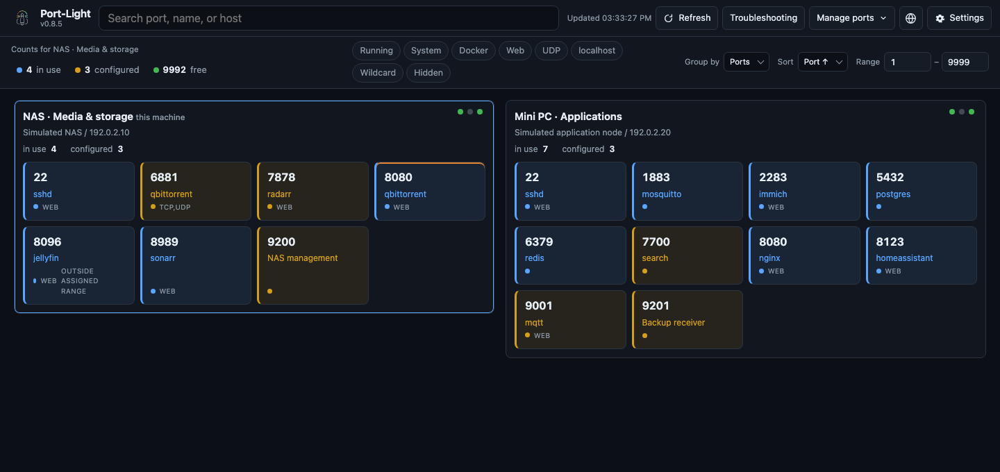
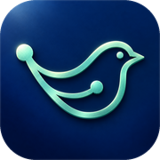

<p align="center">
  
</p>

# Port-Light

A self-hosted dashboard for host port occupancy. It shows host listeners, Docker port mappings, and Compose declarations.

[](LICENSE)
[](https://github.com/StepaniaH/port-light/releases)
[](https://hub.docker.com/r/stepaniah/port-light)
[](https://ca.unraid.net/apps/port-light-1avxhcx0ugtgml)

[English](README.md) · [简体中文](README.zh-CN.md)

[Quick start](#quick-start) · [Documentation](docs/README.md) · [Configuration](docs/configuration.md) · [Sponsors](#sponsors) · [Support](#support-port-light)

<p align="center">
  
</p>

<p align="center"><sub>Sponsored by <a href="https://nodefinch.com"><strong>NodeFinch</strong></a> — keep an eye on the servers you run · <a href="#sponsors">Become a sponsor</a></sub></p>

## Features

- Search by port, service, project, process, or bind address; group Compose ports and collapse contiguous ranges.
- Detect Compose conflicts, generate replacement mappings, manage expiring reservations, and enforce named port-range rules ([port management](docs/port-management.md)).
- View up to 32 peers in waterfall or tab layouts; each machine runs its own instance.
- Run local troubleshooting checks and saved change reports without a model key, with optional BYOK AI assistance ([troubleshooting & BYOK](docs/analysis.md)).
- Connect AI coding tools and scripts through the MCP server, dependency-free CLI, agent skill, HTTP API, webhooks, and Prometheus metrics ([AI setup](docs/ai-setup.md), [CLI](docs/cli.md), [API & MCP](docs/integrations.md)).
- Configure seven UI languages, 22 built-in themes, local SQLite history, and Doctor diagnostics with zero telemetry ([configuration](docs/configuration.md)).

| State | Meaning |
|-------|---------|
| In use | A process is listening or a running container publishes the port |
| Configured | Declared in Compose or a manual entry, with no listener detected |
| Free | Available within the current scan scope (shown when searching for a port) |

## Quick start

Image: [`stepaniah/port-light`](https://hub.docker.com/r/stepaniah/port-light) (`linux/amd64`, `linux/arm64`). Also published to GHCR on tagged releases (`ghcr.io/stepaniah/port-light`). Pin a version tag or digest for reproducible deployments.

```yaml
services:
  port-light:
    image: stepaniah/port-light:v0.9.3
    container_name: port-light
    restart: unless-stopped
    ports:
      - "2100:2100"
    volumes:
      - /path/to/your/compose-stacks:/compose:ro
      - /var/run/docker.sock:/var/run/docker.sock:ro
      - /proc:/host/proc:ro
      - ./data:/data
    environment:
      COMPOSE_SCAN_DIR: /compose
```

```bash
mkdir -p data && docker compose up -d
```

Open `http://localhost:2100`.

Mounting `docker.sock` (even `:ro`) grants Docker API write access — use a [socket proxy](docs/deployment.md#docker-socket-proxy) to restrict it, and set `AUTH_USER` / `AUTH_PASSWORD` for UI/API Basic Auth ([access control](docs/configuration.md#access-control) · [SECURITY.md](SECURITY.md)). On hosts without Docker, set `PORT_LIGHT_SCANNERS=listen,compose`. Failed or stale scans warn and suspend allocation — see [troubleshooting](docs/troubleshooting.md#occupancy-scan-warning).

### Unraid

Install from [Unraid Community Applications](https://ca.unraid.net/apps/port-light-1avxhcx0ugtgml) (**Apps → search `port-light` → StepaniaH's Repository**). See the [Unraid guide](deploy/unraid/README.md) for paths, auth, and upgrades.

## Documentation

Browse the full [Documentation hub](docs/README.md) or jump straight to a guide:

| Topic | Guides |
|-------|--------|
| Setup & operations | [Deployment](docs/deployment.md) · [Unraid](deploy/unraid/README.md) · [Configuration & env vars](docs/configuration.md) · [Troubleshooting](docs/troubleshooting.md) |
| Port workflows | [Port management](docs/port-management.md) · [Local troubleshooting & BYOK](docs/analysis.md) |
| Automation & AI | [AI setup](docs/ai-setup.md) · [CLI](docs/cli.md) · [API, webhooks, metrics & MCP](docs/integrations.md) (`/docs` on a running instance) |
| Trust & internals | [Security](SECURITY.md) · [Data & privacy](docs/configuration.md#data-and-privacy) · [Architecture](docs/architecture.md) · [Contributing](CONTRIBUTING.md) |

## Sponsors

<table>
  <tr>
    <td align="center" width="76">
      <a href="https://nodefinch.com">
        
      </a>
    </td>
    <td>
      <a href="https://nodefinch.com"><strong>NodeFinch</strong></a> — Keep an eye on the servers you run.<br>
      <sub>Shows your servers' online status, performance history, network diagnostics, traffic, and renewals on iPhone. No NodeFinch account required.</sub><br>
      <sub><a href="https://nodefinch.com">Website</a> · <a href="https://apps.apple.com/app/id6830172032">App Store</a></sub>
    </td>
  </tr>
</table>

<sub>Interested in sponsoring Port-Light and showcasing your product or service here? <a href="mailto:StepaniaH0907@gmail.com?subject=Sponsoring%20Port-Light">Become a sponsor</a>.</sub>

## Support Port-Light

Every Port-Light feature stays free and unlocked under MIT with zero telemetry. If Port-Light saves you time across your homelab or fleet, you can back independent maintenance with an optional one-time offline [Supporter Key](https://portlight.stepaniah.me/#support) (verified locally via Ed25519 with zero outbound requests) that lights a theme-matched metallic Harbor Beacon across all 22 built-in themes, or buy a coffee on [Ko-fi](https://ko-fi.com/stepaniah).

## License

[MIT](LICENSE) © 2026 StepaniaH

[Changelog](CHANGELOG.md) · [Security](SECURITY.md) · [Contributing](CONTRIBUTING.md) · [Support](https://portlight.stepaniah.me/#support) · [Ko-fi](https://ko-fi.com/stepaniah)
