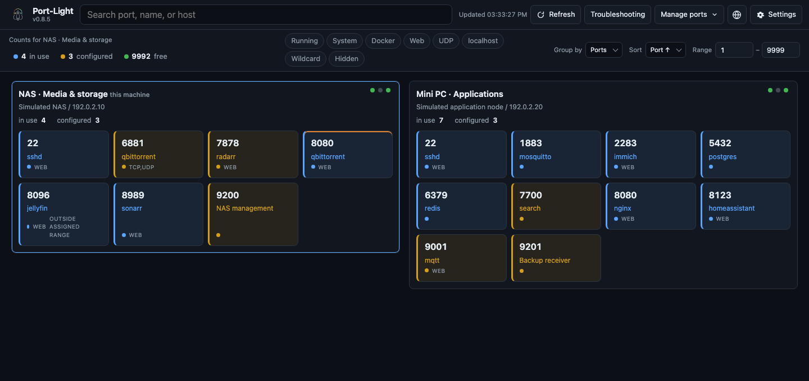

<p align="center">
  
</p>

# Port-Light

自托管的主机端口占用看板，汇总主机监听、Docker 端口映射和 Compose 声明。

[](LICENSE)
[](https://github.com/StepaniaH/port-light/releases)
[](https://hub.docker.com/r/stepaniah/port-light)
[](https://ca.unraid.net/apps/port-light-1avxhcx0ugtgml)

[English](README.md) · [简体中文](README.zh-CN.md)

[快速开始](#快速开始) · [文档中心](docs/README.md) · [配置说明](docs/configuration.md) · [赞助商](#赞助商) · [支持项目](#支持-port-light)

<p align="center">
  
</p>

<p align="center"><sub>由 <a href="https://nodefinch.com/zh-hans/"><strong>NodeFinch</strong></a> 赞助 — 随时掌握你管理的服务器 · <a href="#赞助商">成为赞助商</a></sub></p>

## 功能

- 按端口、服务、项目、进程或绑定地址搜索与筛选，按 Compose 项目/服务分组并折叠连续端口范围。
- 识别 Compose 冲突并生成替代映射，管理带有效期的端口预留与命名端口范围规则（[端口管理](docs/port-management.md)）。
- 汇总最多 32 台其他实例的端口占用，支持瀑布流和标签页布局；每台机器独立运行管理操作。
- 内置纯本地排障工作台与变更报告，无需模型 Key；支持可选 BYOK AI 辅助（[排障与 BYOK](docs/analysis.md)）。
- 提供 MCP 服务器、零依赖 CLI、Agent Skill、HTTP API、Webhook 与 Prometheus 指标，便于 AI 工具和脚本接入（[AI 接入说明](docs/ai-setup.md)、[CLI](docs/cli.md)、[API 与 MCP](docs/integrations.md)）。
- 支持七种界面语言、22 套内置主题、本地 SQLite 历史记录与 Doctor 诊断，全程零遥测（[配置说明](docs/configuration.md)）。

| 状态 | 含义 |
|------|------|
| 占用 | 存在监听进程或运行中的容器映射 |
| 已配置 | 已在 Compose 或手动条目中登记，尚未检测到监听 |
| 空闲 | 当前扫描范围内可用（搜索端口号时显示空闲建议） |

## 快速开始

镜像：[`stepaniah/port-light`](https://hub.docker.com/r/stepaniah/port-light)（`linux/amd64`、`linux/arm64`）。打 tag 发布时也会推到 GHCR（`ghcr.io/stepaniah/port-light`）。固定版本可使用版本标签或镜像摘要。

```yaml
services:
  port-light:
    image: stepaniah/port-light:v0.9.2
    container_name: port-light
    restart: unless-stopped
    ports:
      - "2100:2100"
    volumes:
      - /path/to/your/compose-stacks:/compose:ro
      - /var/run/docker.sock:/var/run/docker.sock:ro
      - /proc:/host/proc:ro
      - ./data:/data
    environment:
      COMPOSE_SCAN_DIR: /compose
```

```bash
mkdir -p data && docker compose up -d
```

打开 `http://localhost:2100`。

挂载 `docker.sock`（即使带 `:ro`）仍授予 Docker API 写权限，建议使用 [socket proxy](docs/deployment.md#docker-socket-proxy) 限制容器权限，并配合 `AUTH_USER` / `AUTH_PASSWORD` 启用页面与 API 的 Basic Auth（[访问控制](docs/configuration.md#access-control) · [SECURITY.md](SECURITY.md)）。无 Docker 环境可设置 `PORT_LIGHT_SCANNERS=listen,compose`。扫描失败或数据过期时会显示警告并暂停端口分配，排查方法见[故障排查](docs/troubleshooting.md#occupancy-scan-warning)。

### Unraid

已上架 [Unraid Community Applications](https://ca.unraid.net/apps/port-light-1avxhcx0ugtgml)（在 **Apps（应用）** 中搜索 `port-light`，安装 **StepaniaH's Repository** 条目）。存储路径、认证和升级方法见 [Unraid 安装指南](deploy/unraid/README.md)。

## 文档

查看完整[文档中心](docs/README.md)（英文技术文档），或直接跳转至对应章节：

| 主题 | 文档 |
|------|------|
| 部署与配置 | [部署指南](docs/deployment.md) · [Unraid 安装指南](deploy/unraid/README.md) · [环境变量与配置说明](docs/configuration.md) · [故障排查](docs/troubleshooting.md) |
| 端口与排障 | [端口管理](docs/port-management.md) · [本地排障与 BYOK](docs/analysis.md) |
| 自动化与 AI | [AI 接入说明](docs/ai-setup.md) · [CLI 客户端](docs/cli.md) · [API、Webhook、指标与 MCP](docs/integrations.md)（运行实例的 `/docs` 提供 OpenAPI 文档） |
| 安全与架构 | [安全说明](SECURITY.md) · [数据与隐私](docs/configuration.md#data-and-privacy) · [系统架构](docs/architecture.md) · [贡献指南](CONTRIBUTING.md) |

## 赞助商

<table>
  <tr>
    <td align="center" width="76">
      <a href="https://nodefinch.com/zh-hans/">
        
      </a>
    </td>
    <td>
      <a href="https://nodefinch.com/zh-hans/"><strong>NodeFinch</strong></a> — 随时掌握你管理的服务器。<br>
      <sub>在 iPhone 上查看服务器的在线状态、历史趋势、网络诊断、流量和续费，无需注册 NodeFinch 账号。</sub><br>
      <sub><a href="https://nodefinch.com/zh-hans/">官网</a></sub>
    </td>
  </tr>
</table>

<sub>欢迎团队或独立开发者赞助 Port-Light 并在此展示你的产品或服务：<a href="mailto:StepaniaH0907@gmail.com?subject=Sponsoring%20Port-Light">成为赞助商</a>。</sub>

## 支持 Port-Light

Port-Light 的全部功能永久保持 MIT 开源、无功能锁、零遥测。如果它在你的家庭实验室或服务器机群中帮到了你，欢迎通过可选的一次性离线[赞助者密钥（Supporter Key）](https://portlight.stepaniah.me/?lang=zh-CN#support)支持独立维护——密钥纯本地 Ed25519 离线验签、零出站请求，点亮后将在全部 22 套内置主题中呈现专属配色的金属港口灯标铭牌；也可以通过 [Ko-fi](https://ko-fi.com/stepaniah) 请作者喝杯咖啡。

## 许可证

[MIT](LICENSE) © 2026 StepaniaH

[更新日志](CHANGELOG.md) · [安全说明](SECURITY.md) · [贡献指南](CONTRIBUTING.md) · [支持项目](https://portlight.stepaniah.me/?lang=zh-CN#support) · [Ko-fi](https://ko-fi.com/stepaniah)
